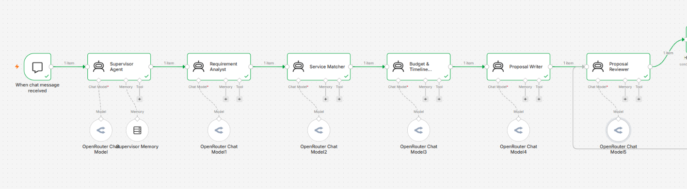
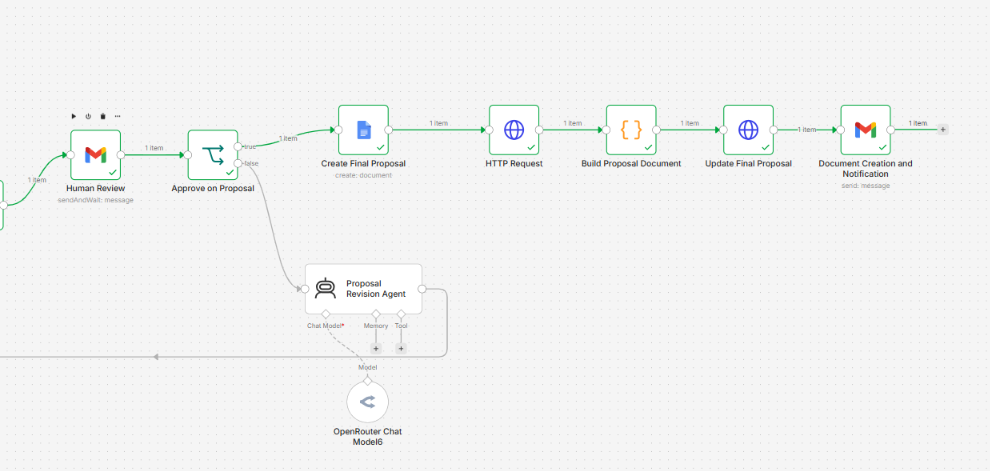

# Vertex Sales Proposal Multi-Agent System

## Project Overview

The Vertex Sales Proposal Multi-Agent System is an AI-powered workflow built using n8n to assist with preparing, reviewing, and revising sales proposals.

The workflow uses multiple AI agents to analyse customer requirements, identify suitable services, check budget and timeline constraints, prepare a proposal, and review it before it is shared for human approval.

## Features

- **Requirement Analysis:** Analyses the customer's needs and requirements.
- **Service Matching:** Matches customer requirements with available services in the service catalogue.
- **Budget and Timeline Checking:** Checks the proposed service against the customer's budget and preferred timeline.
- **Proposal Writing:** Generates a sales proposal based on the collected information.
- **Proposal Review:** Reviews the generated proposal before it moves forward.
- **Human-in-the-Loop Review:** Allows a human to approve or decline a proposal.
- **Proposal Revision:** Supports revising a proposal based on feedback after it is declined.

## Workflow Overview

The workflow is implemented in n8n and contains multiple connected stages for proposal preparation, review, and revision.

### Part 1

### Part 2

## Technologies Used

- **n8n** — Workflow automation and orchestration.
- **AI model via OpenRouter** — AI-powered analysis and proposal generation.
- **Email integration** — Used for proposal-related communication where configured.
- **JSON** — Export format for the n8n workflow.

## Workflow Process

1. Receive customer requirements.
2. Analyse the requirements.
3. Match the requirements with available services.
4. Check budget and timeline information.
5. Generate a sales proposal.
6. Review the proposal.
7. Send it for human approval or rejection.
8. Revise the proposal based on feedback when required.

## How to Import the Workflow

1. Set up an n8n instance.
2. Download `proposal-recommendation-workflow.json` from this repository.
3. Open n8n.
4. Import the JSON workflow using the workflow import option.
5. Configure the required credentials and integrations.
6. Test the workflow with sample customer information before using it.

**Note:** The workflow may require additional configuration, credentials, and external services to run correctly. Do not share your API keys or other secrets publicly.

## Project Purpose

This project demonstrates how AI agents and workflow automation can support a sales proposal process, from analysing customer needs to generating a proposal and incorporating human feedback.

## Author

**Salina Pudasaini**

GitHub: [PudasainiSalina2060](https://github.com/PudasainiSalina2060)
